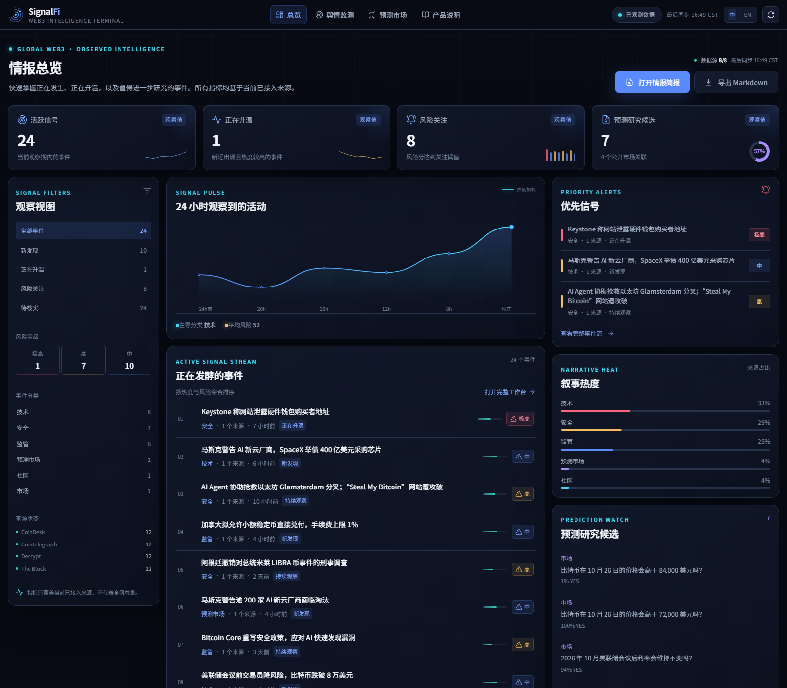
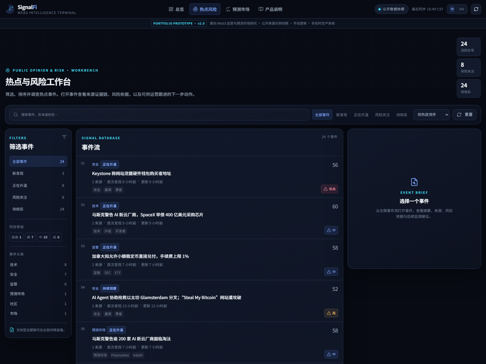
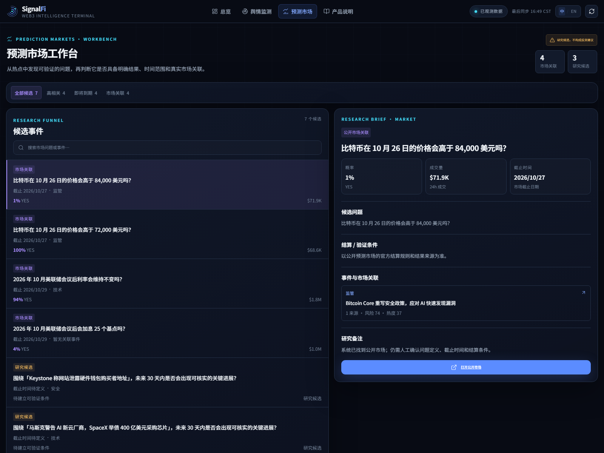
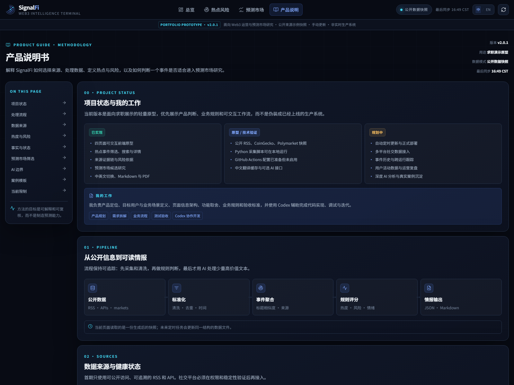

# SignalFi · Web3 Operations & Prediction Research Workbench

面向 Web3 用户运营与预测市场研究的求职作品集原型，用于展示热点发现、风险判断、运营行动和预测市场候选研究的工作流。

当前版本：**v2.0.1-job-demo**。
公开 RSS/API 由 GitHub Actions 每 6 小时尝试采集并发布；项目不是实时生产系统。

在线演示：https://reynald0588.github.io/signalfi/



## 页面

| 页面 | 路径 | 核心任务 |
|---|---|---|
| Overview | `index.html` | 快速掌握当前热点、风险和预测研究机会 |
| Signals | `signals.html` | 热点与风险工作台：搜索、筛选、排序并调查事件 |
| Prediction Research | `prediction.html` | 预测市场工作台：判断热点是否适合转化为可验证的市场问题 |
| Product Guide | `methodology.html` | 产品说明书：项目状态、我的工作、数据来源、评分规则和系统限制 |





## 本地运行

最简单方式：双击 `start_local.bat`。

它会：

1. 执行 `python scripts\collect.py`
2. 读取公开 RSS、CoinGecko 与 Polymarket 数据
3. 生成 `data/latest.json` 和 `assets/latest-data.js`
4. 启动本地静态服务器并打开 `http://127.0.0.1:8000`

手动运行：

```powershell
python scripts\collect.py
python -m http.server 8000 --bind 127.0.0.1
```

只更新数据：双击 `refresh_data.bat`。

## 品牌系统

- 颜色 Token：`assets/tokens.css`
- Radar Signal 图标：`assets/brand/signalfi-mark.svg`
- 应用图标 / favicon：`assets/brand/signalfi-app-icon.svg`、`assets/favicon.svg`
- 图标 + 字标：`assets/brand/signalfi-logo.svg`
- 品牌规范板：`design/signalfi-brand-system.png`
- PDF 样例：`design/signalfi-brief-sample.pdf`
- 三栏布局设计板：`design/signalfi-homepage-v2.png`

颜色规则：

- Primary Blue `#5B8CFF`：品牌与主交互
- Signal Cyan `#42D9F5`：实时状态与数据强调
- Signal Teal `#35D0B0`：Confirmed / Healthy
- Alert Amber `#F6BD60`：Unverified / Watch
- Risk Red `#FF647C`：只用于风险和警报
- Research Violet `#A78BFA`：预测市场研究

所有页面使用同一套 CSS Variables，不在组件中重复定义品牌色。

## 前端结构

```text
index.html                 Overview
signals.html               Signals 工作台
prediction.html            Prediction Research
methodology.html           Methodology
assets/tokens.css          品牌、表面、文字与状态 Token
assets/styles.css          基础组件和共享样式
assets/stage1.css          v2.0 页面布局与响应式
assets/core.js             图标、Header、数据加载、语言切换、日报
assets/overview.js         Overview 渲染与筛选
assets/signals.js          Signals 搜索、筛选、详情
assets/prediction.js       预测候选、Tabs、研究详情
assets/methodology.js      产品说明书、方法论与案例模板
assets/latest-data.js      内嵌数据快照
assets/vendor/jspdf.umd.min.js  PDF 生成库
data/latest.json           最新采集结果
data/seed_events.json      离线演示数据
scripts/collect.py         公开数据采集与输出
scripts/analysis.py        聚类、热度、风险、情绪、日报
scripts/ai_processor.py    可选 AI 分析
scripts/translator.py      中文翻译缓存与可选 AI 批量翻译
scripts/seed_translations.py 当前快照的中文翻译种子
data/translation_cache.json 已翻译标题、摘要与市场问题缓存
```

## 数据契约

四个页面读取同一份 `data/latest.json`，主要字段：

- `events[]`：事件、原始标题/摘要、中文标题/摘要、来源、热度、风险、情绪、时间和标签
- `market`：BTC / ETH / SOL、Fear & Greed
- `prediction_markets[]`：公开市场问题、中文问题、概率、成交量、截止时间
- `report`：结构化情报简报
- `sources[]`：数据源健康状态
- `trend`：24 小时观察趋势
- `stats`：聚合指标

前端会从事件与公开市场数据中派生：

- 活跃信号
- 正在升温
- 风险关注
- 预测研究候选
- 证据状态
- 事件研究问题

## 已实现的交互

- 四个页面完整导航和共享 Header
- 中文 / 英文 UI 切换并保存到 localStorage
- Overview 快速筛选、分类筛选、风险关注
- Signals 搜索、状态筛选、风险筛选、分类筛选、排序
- 中文界面会使用中文标题、摘要和市场问题，同时保留必要的英文技术标注
- Prediction Research Tabs：全部 / 高相关 / 即将到期 / 市场关联
- 预测候选详情：问题、结算条件、截止时间、概率、成交量和关联事件
- 产品说明书锚点导航和数据源动态状态
- 情报简报弹窗
- Markdown 导出
- 下载 PDF（Canvas 渲染，不依赖打印对话框）
- 移动端导航、2 × 2 指标卡和全屏详情抽屉

## v2.0 浏览器验收

已检查：

- 1440px 桌面端四页面无横向溢出
- 390px 手机端无横向溢出
- Overview 三栏实际宽度接近 20 / 50 / 30
- Header 高度约 60px，移动端约 56px
- 风险状态同时使用图标、文字和颜色
- 24 个事件、7 个预测研究候选正常渲染
- 中文模式内容已翻译，导航和功能性标签随语言切换
- 正文与元信息字号不低于 11px，核心标题与数字使用统一字号体系
- PDF 已验证可生成 2 页 A4 文件
- 搜索、筛选、Tabs、事件详情和移动抽屉可用
- Markdown 文件可以成功导出
- 无阻塞性 JavaScript 异常

## 演示视频方案

完整分镜、讲解文案和录制检查清单见：`docs/video-demo-plan.md`。

## 当前边界

- 当前演示版使用公开来源示例快照，不声称秒级实时
- 跨运行的事件历史去重仍需持久化事件状态
- X / Telegram 全量数据尚未接入
- 预测研究候选会明确区分 `Market Linked` 与 `Research Candidate`
- 规则评分与 AI 输出均不作为投资建议

## 后续阶段

1. 真实数据源稳定性与公开公告接入
2. 事件状态持久化与跨运行跟踪
3. AI 结构化简报优化
4. 预测市场关联与概率变化
5. 自定义域名或腾讯云迁移
6. 真实案例研究、简历和演示视频

## AI 配置

没有 AI Key 时系统使用规则引擎，网站仍可运行。

复制 `.env.example` 为 `.env` 后填写：

```env
AI_API_KEY=
AI_BASE_URL=https://api.deepseek.com/v1
AI_MODEL=deepseek-chat
```

不要把 Key 写入前端 JavaScript 或公开仓库。

## GitHub Pages

`.github/workflows/update.yml` 已配置每 6 小时刷新与 GitHub Pages 部署。首次发布时：

1. 创建公开 GitHub 仓库并推送项目
2. Settings → Pages → Build and deployment → Source 选择 `GitHub Actions`
3. 打开 Actions → `Refresh SignalFi and deploy` → Run workflow

工作流使用免费公开源与规则引擎，不调用 AI；如果本轮没有采集到任何实时事件，工作流会失败并保留上一次成功发布的页面，避免用示例数据覆盖线上版本。

